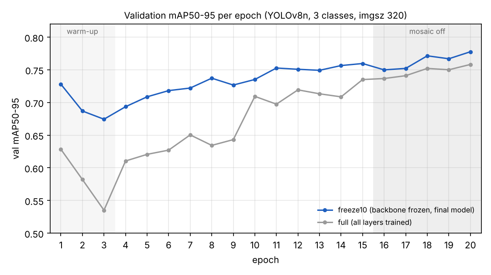

# YOLOv8n 3개 부류 fine-tuning: 코끼리 · 코뿔소 · 얼룩말

머신러닝 과목 과제(컴퓨터 비전 IV, YOLO)로 COCO 사전학습 YOLOv8n을 elephant / rhino / zebra 3개 부류에 맞게 fine-tuning 하고, 학습한 모델로 5초 분량의 객체 탐지·추적 영상을 만들었다.


## 결과 요약

학습에 쓰지 않은 테스트 178장(객체 309개), 입력 크기 320 기준.

| 모델 | Precision | Recall | mAP50 | mAP50-95 | 학습 시간 (CPU 2코어) |
| --- | --- | --- | --- | --- | --- |
| **freeze10 (최종, `weights/best.pt`)** | 0.948 | 0.930 | 0.975 | 0.795 | 16.7분 |
| full (`weights/best_full.pt`) | 0.949 | 0.908 | 0.966 | 0.781 | 27.3분 |

| 부류 (최종 모델) | Precision | Recall | mAP50 | mAP50-95 |
| --- | --- | --- | --- | --- |
| elephant | 0.936 | 0.949 | 0.978 | 0.777 |
| rhino | 0.963 | 0.960 | 0.986 | 0.880 |
| zebra | 0.946 | 0.881 | 0.963 | 0.727 |

- **freeze10**: 백본(0~9번 층)을 고정하고 넥·헤드만 학습. 강의 슬라이드 CV-4 p48의 전이학습 방식이다.
- **full**: 모든 층을 다시 학습.
- 이번 실험에서는 백본을 고정한 쪽이 학습 시간은 약 60%만 쓰고 성능은 조금 높았다. 테스트셋이 작고 방식마다 한 번씩만 학습했으므로 0.01~0.02 차이는 다시 학습하면 달라질 수 있다.
- COCO 사전학습 모델을 그대로 쓰면 rhino는 아예 찾을 수 없고(COCO에 없는 부류), 테스트셋 코뿔소 사진 55장 중 39장에서 'elephant' 박스를 냈다. fine-tuning 뒤 elephant 정밀도는 0.717에서 0.936으로 올랐다.



## 데이터

- 출처: [Ultralytics African Wildlife](https://docs.ultralytics.com/datasets/detect/african-wildlife/) (buffalo, elephant, rhino, zebra 4개 부류, 1,504장, AGPL-3.0)
- buffalo가 들어 있는 이미지는 통째로 빼고 나머지 3개 부류만 사용 (라벨만 지우면 들소가 배경으로 학습되기 때문)
- 원본의 train / val / test 분할을 그대로 유지

| 분할 | 이미지 | elephant (이미지 / 객체) | rhino (이미지 / 객체) | zebra (이미지 / 객체) |
| --- | --- | --- | --- | --- |
| train | 784 | 271 / 557 | 261 / 396 | 259 / 565 |
| val | 163 | 52 / 90 | 55 / 85 | 57 / 110 |
| test | 178 | 58 / 99 | 55 / 75 | 66 / 135 |

## 학습 설정

| 항목 | 값 |
| --- | --- |
| 사전학습 가중치 | `yolov8n.pt` (COCO 80부류). 이름이 같은 elephant·zebra의 분류 출력 가중치는 이어받고 rhino는 새로 학습 |
| 입력 크기 | 320 × 320 |
| epoch / batch | 20 / 16 |
| 최적화 | AdamW, 학습률 0.001429 (`optimizer=auto`), 3 epoch warm-up |
| 데이터 증강 | Ultralytics 기본값 (모자이크는 마지막 5 epoch에서 끔) |
| 장치 | CPU 2코어 (GPU 없음) |

## 탐지·추적 영상

- `video/track_demo_5s.mp4`: 1280×720, 30fps, 150프레임(5.00초). 최종 모델 + ByteTrack, 추론 입력 416, 신뢰도 0.25 이상
- `video/source_pan_5s.mp4`: 추적에 넣은 원본 영상. 실제 동물 영상을 구할 수 없어 **테스트 이미지 3장을 가로로 이어 붙이고 화면을 왼쪽에서 오른쪽으로 움직여 만든 패닝 영상**이다 (`scripts/make_demo_video.py`). 동물이 스스로 움직이는 실제 영상이 아니다.
- `results/trajectories.csv`: 프레임별 추적 ID, 부류, 신뢰도, 박스 중심점
- 영상 속 동물 11마리 중 10마리는 하나의 ID로 끝까지 따라갔다. 겹쳐 선 코끼리 두 마리는 한 박스로 잡혔고, 새끼 코뿔소는 ID는 유지됐지만 계속 elephant로 분류됐다.

실제 영상이 있으면 그대로 넣으면 된다.

```bash
python scripts/track.py --weights weights/best.pt --source 내영상.mp4 --out video/my_track.mp4 --imgsz 416
```

## 재현 방법

```bash
pip install -r requirements.txt

# 1) 데이터 받기 + 3개 부류로 정리
curl -L -o african-wildlife.zip https://github.com/ultralytics/assets/releases/download/v0.0.0/african-wildlife.zip
unzip -q african-wildlife.zip -d datasets_raw
python scripts/prepare_dataset.py --src datasets_raw --dst datasets/wildlife3

# 2) 학습 (GPU가 있으면 --device 0)
python scripts/train.py --mode freeze10 --data datasets/wildlife3/wildlife3.yaml
python scripts/train.py --mode full     --data datasets/wildlife3/wildlife3.yaml

# 3) 테스트셋 평가 (+ COCO 사전학습 모델 비교, 혼동행렬)
python scripts/evaluate.py --weights runs/ft_freeze10/weights/best.pt --name freeze10 --baseline yolov8n.pt
python scripts/evaluate.py --weights runs/ft_full/weights/best.pt --name full
python scripts/confusion.py --weights runs/ft_freeze10/weights/best.pt

# 4) 추적 영상
python scripts/make_demo_video.py --images "datasets/wildlife3/images/test/2 (227).jpg" \
    "datasets/wildlife3/images/test/3 (209).jpg" "datasets/wildlife3/images/test/4 (213).jpg" \
    --out video/source_pan_5s.mp4
python scripts/track.py --weights runs/ft_freeze10/weights/best.pt --source video/source_pan_5s.mp4 \
    --out video/track_demo_5s.mp4 --imgsz 416
```

## 파일 구조

| 경로 | 내용 |
| --- | --- |
| `weights/best.pt` | 최종 모델 (freeze10) |
| `weights/best_full.pt` | 비교 모델 (full) |
| `video/` | 추적 결과 영상, 입력 패닝 영상 |
| `scripts/prepare_dataset.py` | 4개 부류 원본에서 3개 부류 데이터셋 만들기 |
| `scripts/train.py` | fine-tuning (full / freeze10) |
| `scripts/evaluate.py` | test 분할 성능, COCO 사전학습 모델과 비교 |
| `scripts/confusion.py` | 신뢰도 0.25 · IoU 0.5 기준 혼동행렬 |
| `scripts/make_demo_video.py` | 테스트 이미지로 5초 패닝 영상 만들기 |
| `scripts/track.py` | 탐지 + ByteTrack 추적, 궤적 CSV 저장 |
| `results/` | 테스트 지표 JSON, epoch별 학습 로그 CSV, 혼동행렬 CSV, 궤적 CSV, 그림 |

## 라이선스

[Ultralytics](https://github.com/ultralytics/ultralytics) 코드와 사전학습 가중치, African Wildlife 데이터셋이 AGPL-3.0이어서 이 저장소도 AGPL-3.0을 따른다.
