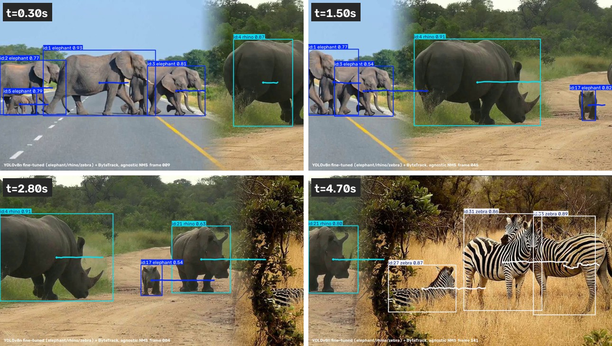

# YOLOv8n 3개 부류 fine-tuning: 코끼리 · 코뿔소 · 얼룩말

머신러닝 과목 과제 2(컴퓨터 비전 IV, YOLO)로 COCO 사전학습 YOLOv8n을 elephant / rhino / zebra 3개 부류에 맞게 fine-tuning 하고, 학습한 모델로 5초 분량의 객체 탐지·추적 영상을 만들었다.



| 과제 요구사항 (CV-4 p.49) | 결과물 |
| --- | --- |
| 3개 부류, 100장 이상 이미지 | 1,125장. 학습 분할(784장)만으로도 부류마다 259장 이상 |
| 3개 부류 학습 | `weights/best.pt` (최종, 백본 고정), `weights/best_full.pt` (비교용, 전체 층 학습) |
| 학습된 부류의 탐지·추적 5초 영상 | `video/track_demo_5s.mp4` (1280×720, 30fps, 150프레임, H.264) |
| 학습 모델·동영상 공개 | 이 저장소 |

## 결과 요약

학습에 쓰지 않은 테스트 178장(객체 309개), 입력 크기 320 기준.

| 모델 | Precision | Recall | mAP50 | mAP50-95 | 학습 시간 (CPU 2코어) |
| --- | --- | --- | --- | --- | --- |
| **freeze10 (최종, `weights/best.pt`)** | 0.948 | 0.930 | 0.975 | 0.795 | 16.7분 |
| full (`weights/best_full.pt`) | 0.949 | 0.908 | 0.966 | 0.781 | 27.3분 |

| 부류 (최종 모델) | Precision | Recall | mAP50 | mAP50-95 |
| --- | --- | --- | --- | --- |
| elephant | 0.936 | 0.949 | 0.978 | 0.777 |
| rhino | 0.963 | 0.960 | 0.986 | 0.880 |
| zebra | 0.946 | 0.881 | 0.963 | 0.727 |

- **freeze10**: 백본(0~9번 층)을 고정하고 넥·헤드만 학습. 강의 슬라이드 CV-4 p.48의 전이학습 방식이다.
- **full**: 모든 층을 다시 학습.

### 시드를 바꿔 반복한 결과

방식마다 시드 0(위 결과)·1·2로 세 번씩 학습해 같은 테스트셋으로 쟀다(입력 320). 시드 1·2는 같은 버전·설정으로 다시 학습했다(CPU 4코어에서 4개를 동시에 돌려서 학습 시간 비교에는 쓰지 않음).

| 테스트 mAP50-95 | 시드 0 | 시드 1 | 시드 2 | 평균 ± 표준편차 |
| --- | --- | --- | --- | --- |
| freeze10 | 0.795 | 0.805 | 0.785 | 0.795 ± 0.010 |
| full | 0.781 | 0.782 | 0.793 | 0.785 ± 0.007 |
| 차이 (freeze10 − full) | +0.014 | +0.023 | −0.008 | +0.010 |

- 검증셋 mAP50-95는 세 시드 모두 20 epoch 내내 freeze10이 앞섰다.
- 테스트에서는 freeze10이 평균 0.010 높았지만 시드 2에서는 full이 높았다. 차이가 시드에 따른 흔들림(표준편차 약 0.01)과 비슷한 크기라 "비슷하거나 조금 높다"까지가 안전한 결론이다. mAP50 평균은 0.970 vs 0.965였고, 부류별로는 zebra mAP50-95만 세 번 모두 freeze10이 높았다(평균 0.728 vs 0.711).
- freeze10은 학습 시간이 약 60%라서, 성능이 비슷하면 freeze10을 쓰는 편이 낫다.
- 숫자는 `results/test_metrics_<방식>_s<시드>.json`, 학습 로그는 `results/train_log_<방식>_s<시드>.csv`.


### COCO 사전학습 모델과 비교

COCO 80개 부류에는 rhino가 없어서 사전학습 모델 그대로는 코뿔소를 찾을 수 없다. 대신 테스트셋 코뿔소 사진 55장 중 29장에서 elephant 박스를, 22장에서 cow 박스를 냈다(입력 320, 신뢰도 0.25 이상).

| 입력 320 | COCO 그대로, 178장 | freeze10, 178장 | COCO 그대로, 코뿔소 없는 123장 | freeze10, 코뿔소 없는 123장 |
| --- | --- | --- | --- | --- |
| elephant Precision | 0.717 | 0.936 | 0.979 | 0.983 |
| elephant mAP50-95 | 0.683 | 0.777 | 0.814 | 0.787 |
| zebra mAP50-95 | 0.757 | 0.727 | 0.759 | 0.725 |
| rhino mAP50-95 | 탐지 불가 | 0.880 | | |

- 테스트 전체에서 COCO 모델의 elephant 정밀도가 0.717에 그친 것은 코뿔소에 낸 elephant 박스 때문이다. 코뿔소 사진을 빼고 재면 0.979로 오른다.
- 같은 사진끼리 비교하면 fine-tuning 모델의 박스 정확도(mAP50-95)는 COCO 모델보다 조금 낮다(elephant 0.814 → 0.787, zebra 0.759 → 0.725). fine-tuning으로 얻은 것은 rhino를 새로 찾고 코뿔소를 코끼리와 헷갈리지 않게 된 것이다.
- 숫자는 `results/test_metrics_freeze10.json`의 `coco_pretrained_*`, `*_no_rhino_images`, `coco_on_rhino_images` 항목.

### 혼동행렬 (최종 모델, 신뢰도 0.25 · IoU 0.5)

| 정답 \ 예측 | elephant | rhino | zebra | 놓침 |
| --- | --- | --- | --- | --- |
| elephant (99) | 95 | 0 | 0 | 4 |
| rhino (75) | 1 | 73 | 1 | 0 |
| zebra (135) | 0 | 0 | 125 | 10 |
| 배경 (오탐) | 10 | 5 | 19 | |

부류끼리 헷갈린 것은 코뿔소 2마리뿐이다. 놓친 동물 14마리 중 11마리는 다른 동물과 박스가 절반 이상 겹쳐 있었고, 나머지 3마리는 사진 넓이의 1%도 안 되는 먼 동물이었다(`results/confusion_misses_freeze10.csv`). Ultralytics 8.4.215의 기본 혼동행렬은 mAP 계산용 설정대로 신뢰도 0.001 이상 예측을 모두 세어 배경 칸에 2,407개가 쌓이므로, 영상 추론과 같은 기준으로 따로 셌다(`scripts/confusion.py`).

## 데이터

- 출처: [Ultralytics African Wildlife](https://docs.ultralytics.com/datasets/detect/african-wildlife/) (buffalo, elephant, rhino, zebra 4개 부류, 1,504장). 원본은 Bianca Ferreira가 Kaggle에 공개한 데이터이고, Ultralytics 배포 zip에는 AGPL-3.0 라이선스 파일이 들어 있다.
- buffalo가 들어 있는 이미지는 통째로 빼고 나머지 3개 부류만 사용 (라벨만 지우면 들소가 배경으로 학습되기 때문)
- 원본의 train / val / test 분할을 그대로 유지. test는 학습에도, 가장 좋은 epoch를 고르는 데도 쓰지 않았다.

| 분할 | 이미지 | elephant (이미지 / 객체) | rhino (이미지 / 객체) | zebra (이미지 / 객체) |
| --- | --- | --- | --- | --- |
| train | 784 | 271 / 557 | 261 / 396 | 259 / 565 |
| val | 163 | 52 / 90 | 55 / 85 | 57 / 110 |
| test | 178 | 58 / 99 | 55 / 75 | 66 / 135 |

## 학습 설정

| 항목 | 값 |
| --- | --- |
| 사전학습 가중치 | `yolov8n.pt` (COCO 80부류). 이름이 같은 elephant·zebra의 분류 출력 가중치는 이어받고 rhino는 새로 학습 |
| 입력 크기 | 320 × 320 |
| epoch / batch | 20 / 16 (epoch당 49 iteration) |
| 최적화 | AdamW, 학습률 0.001429 (`optimizer=auto`), 3 epoch warm-up 뒤 선형 감소 |
| 데이터 증강 | Ultralytics 기본값 (모자이크는 마지막 5 epoch에서 끔) |
| 장치 | CPU 2코어 (GPU 없음). epoch당 freeze10 약 50초, full 약 82초 |

## 탐지·추적 영상

- `video/track_demo_5s.mp4`: 1280×720, 30fps, 150프레임(5.00초). 최종 모델 + ByteTrack, 추론 입력 416, 신뢰도 0.25 이상, 부류 구분 없는 NMS
- `video/source_pan_5s.mp4`: 추적에 넣은 원본 영상. 실제 동물 영상을 구할 수 없어 **테스트 이미지 3장을 가로로 이어 붙이고 화면을 왼쪽에서 오른쪽으로 움직여 만든 패닝 영상**이다 (`scripts/make_demo_video.py`). 동물이 스스로 움직이는 실제 영상이 아니다.
- `results/trajectories.csv`: 프레임별 추적 ID, 부류, 신뢰도, 박스 중심점과 좌표

영상 속 동물 11마리 중 10마리는 ID 하나로 화면을 벗어나거나 영상이 끝날 때까지 이어졌다. 겹쳐 선 코끼리 두 마리는 박스 하나로 잡혔다. 새끼 코뿔소는 ID는 유지됐지만 91프레임 내내 elephant로 분류됐고, 오른쪽 코뿔소는 ID 하나로 99프레임 이어졌지만 그중 33프레임은 elephant로 흔들렸다.

**추적 설정 비교** (`results/tracking_settings.csv`, `scripts/compare_tracking.py`). 10프레임 이상 이어진 ID가 동물 수(11)에 가깝고 짧은 ID가 적을수록 좋다.

| 추론 입력 | NMS | 전체 ID | 10프레임 이상 ID | 짧게 끊긴 ID (중복 박스 / 가장자리 / 기타) | 테스트 mAP50-95 |
| --- | --- | --- | --- | --- | --- |
| 320 | 부류별 | 20 | 14 | 6 (3 / 2 / 1) | 0.795 |
| 320 | 부류 구분 없음 | 11 | 9 | 2 (0 / 2 / 0) | 0.795 |
| 416 | 부류별 (처음 만든 영상) | 25 | 11 | 14 (12 / 1 / 1) | 0.794 |
| **416** | **부류 구분 없음 (최종)** | **14** | **10** | **4 (3 / 1 / 0)** | **0.794** |
| 640 | 부류별 | 16 | 11 | 5 (3 / 2 / 0) | 0.604 |
| 640 | 부류 구분 없음 | 12 | 10 | 2 (0 / 2 / 0) | 0.604 |

- 처음 만든 영상(416, 부류별 NMS)에서 짧게 끊긴 ID 14개 중 12개는 이미 추적 중인 동물 위에 겹쳐 나온 중복 박스였다. Ultralytics의 NMS는 기본으로 부류마다 따로 돌아서, 한 코뿔소에 rhino 박스와 elephant 박스가 함께 남으면 추적기가 두 번째 박스에 새 ID를 붙인다. `agnostic_nms=True`로 바꿔 전체 ID를 25개에서 14개로 줄였다.
- 640은 이 영상에서 ID가 가장 깔끔했지만 테스트 mAP50-95가 0.604로 떨어져(320에서 학습한 모델이라 물체가 학습 때보다 크게 보임) 쓰지 않았다. 320은 코끼리 5마리를 ID 3개로만 잡았고 오른쪽 코뿔소를 97프레임 중 71프레임에서 elephant로 분류했다. 테스트 성능이 320과 같고(0.794) 영상 속 동물 크기가 학습 때와 가장 비슷한 416을 골랐다.

실제 영상이 있으면 그대로 넣으면 된다.

```bash
python scripts/track.py --weights weights/best.pt --source 내영상.mp4 --out video/my_track.mp4 --csv results/my_trajectories.csv
```

## 재현 방법

```bash
pip install -r requirements.txt

# 1) 데이터 받기 + 3개 부류로 정리
curl -L -o african-wildlife.zip https://github.com/ultralytics/assets/releases/download/v0.0.0/african-wildlife.zip
unzip -q african-wildlife.zip -d datasets_raw
python scripts/prepare_dataset.py --src datasets_raw --dst datasets/wildlife3

# 2) 학습 (GPU가 있으면 --device 0). 결과는 runs/ft_<방식>
python scripts/train.py --mode freeze10 --data datasets/wildlife3/wildlife3.yaml
python scripts/train.py --mode full     --data datasets/wildlife3/wildlife3.yaml
#    시드를 바꾼 반복 학습. 결과는 runs/ft_<방식>_s<시드>
python scripts/train.py --mode freeze10 --seed 1
python scripts/train.py --mode full     --seed 1

# 3) 테스트셋 평가 (+ COCO 사전학습 모델 비교, 혼동행렬)
python scripts/evaluate.py --weights runs/ft_freeze10/weights/best.pt --name freeze10 --baseline yolov8n.pt
python scripts/evaluate.py --weights runs/ft_full/weights/best.pt --name full
python scripts/evaluate.py --weights runs/ft_freeze10/weights/best.pt --name freeze10_416 --imgsz 416
python scripts/evaluate.py --weights runs/ft_freeze10/weights/best.pt --name freeze10_640 --imgsz 640
python scripts/evaluate.py --weights runs/ft_freeze10_s1/weights/best.pt --name freeze10_s1
python scripts/confusion.py --weights runs/ft_freeze10/weights/best.pt \
    --out results/confusion_conf025_freeze10.csv --misses-out results/confusion_misses_freeze10.csv
python scripts/confusion.py --weights runs/ft_full/weights/best.pt --out results/confusion_conf025_full.csv
python scripts/plot_curves.py      # results/train_log_*.csv -> results/learning_curves.png

# 4) 추적 영상
python scripts/make_demo_video.py --images "datasets/wildlife3/images/test/2 (227).jpg" \
    "datasets/wildlife3/images/test/3 (209).jpg" "datasets/wildlife3/images/test/4 (213).jpg" \
    --out video/source_pan_5s.mp4
python scripts/track.py --weights runs/ft_freeze10/weights/best.pt --source video/source_pan_5s.mp4 \
    --out video/track_demo_5s.mp4 --csv results/trajectories.csv --snapshot-out results/tracking_frames.jpg
python scripts/compare_tracking.py --weights runs/ft_freeze10/weights/best.pt --source video/source_pan_5s.mp4
python scripts/track_stats.py --csv results/trajectories.csv    # ID별 프레임 수, 짧은 ID의 원인
```

`runs/`의 학습 로그는 `results/train_log_<이름>.csv`로 복사해 두었다. 같은 버전(Ultralytics 8.4.215, PyTorch 2.15.0, CPU)에서 `weights/`의 두 모델과 `video/source_pan_5s.mp4`로 3단계 평가와 4단계 추적을 다시 돌리면 `results/`의 숫자가 그대로 나왔다. 입력 영상을 `make_demo_video.py`로 다시 만들면 압축 결과가 조금 달라져 추적 ID 번호와 행 수는 조금 바뀌지만, ID 통계(전체 14개, 10프레임 이상 10개, 짧은 ID 4개)는 같았다. 시드 0 freeze10 학습은 6 epoch 뒤 끊겨 `last.pt`에서 이어 학습했기 때문에, 2단계를 처음부터 다시 돌리면 숫자가 조금 다를 수 있다.

## 파일 구조

| 경로 | 내용 |
| --- | --- |
| `weights/best.pt` | 최종 모델 (freeze10, 6.5MB) |
| `weights/best_full.pt` | 비교 모델 (full) |
| `video/` | 추적 결과 영상, 입력 패닝 영상 |
| `scripts/prepare_dataset.py` | 4개 부류 원본에서 3개 부류 데이터셋 만들기 |
| `scripts/train.py` | fine-tuning (full / freeze10, `--seed`로 반복 학습) |
| `scripts/evaluate.py` | test 분할 성능, COCO 사전학습 모델과 비교 (코뿔소 사진을 뺀 비교 포함) |
| `scripts/confusion.py` | 신뢰도 0.25 · IoU 0.5 기준 혼동행렬, 놓친 박스 목록 |
| `scripts/plot_curves.py` | 학습 로그로 학습 곡선 그림 그리기 |
| `scripts/make_demo_video.py` | 테스트 이미지로 5초 패닝 영상 만들기 |
| `scripts/track.py` | 탐지 + ByteTrack 추적, 궤적 CSV, 프레임 그림 저장 |
| `scripts/track_stats.py` | 궤적 CSV 요약 (ID별 프레임 수, 짧은 ID의 원인) |
| `scripts/compare_tracking.py` | 추론 입력 크기 · NMS 방식별 추적 결과 비교 |
| `results/test_metrics_*.json` | 테스트 지표 (최종·비교 모델, 입력 416·640, 반복 학습, COCO 사전학습 모델) |
| `results/train_log_*.csv`, `results/train_args_*.yaml` | epoch별 학습 로그, 학습 설정 |
| `results/confusion_*.csv` | 혼동행렬, 놓친 박스 목록 |
| `results/trajectories.csv`, `results/tracking_settings.csv` | 최종 영상의 궤적, 추적 설정 비교 |
| `results/*.png`, `results/*.jpg` | 학습 곡선, 추적 프레임, Ultralytics가 그린 학습 결과·PR 곡선·라벨 분포 |

## 라이선스

[Ultralytics](https://github.com/ultralytics/ultralytics) 코드와 사전학습 가중치가 AGPL-3.0이어서 이 저장소도 AGPL-3.0으로 공개한다. 데이터셋 이미지는 저장소에 넣지 않았다. 영상과 `results/tracking_frames.jpg`에만 테스트 이미지 3장이 들어 있다.
